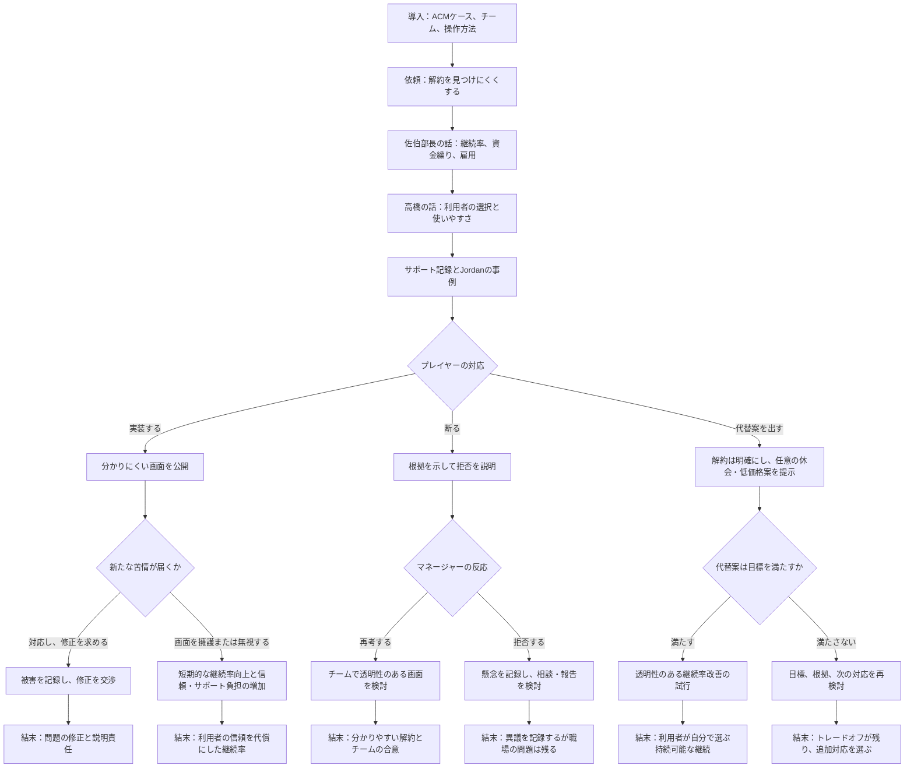

# 初期設計案 — 『出口はそこにある』

> **段階：** Twine制作前の初期設計案。チームで確認するためのたたき台です。完成版の分岐図と貢献割合は、制作後に実際の内容と作業に合わせて更新します。

## 企画情報と参考ケース

- **仮題：** 『出口はそこにある』（英題：*The Exit Is Still There*）
- **チーム名：** Team Nagano
- **ACMケース：** **Dark UX Patterns（ダークなUXパターン）**
- **ACMケースへのリンク：** https://ethics.acm.org/code-of-ethics/using-the-code/case-dark-ux-patterns/
- **創作上の展開：** ACMケースでは、顧客を高価な選択肢へ誘導する分かりにくい画面の実装を求められた技術者の葛藤が扱われています。このゲームでは、題材を学習アプリのサブスクリプション解約画面に変え、解約を見つけにくくするよう求められたエンジニアを描きます。会社側の利益のために、利用者を意図的に誤解させる画面を実装してよいのか、という元ケースの中心的な葛藤を保ちつつ、複数の関係者の視点と選択後の影響を加えます。

## 1. シナリオ概要

プレイヤーは、小規模な月額制学習アプリ「LearnLoop」の若手エンジニアです。資金繰りの見通しから講座削減の可能性が出てきたある日、中年のプロダクト責任者・佐伯部長から、解約ボタンを何画面も先に移し、割引付きの年間プランを目立たせるよう頼まれます。佐伯部長は、利用者をつなぎとめれば収入を維持でき、雇用や無料講座を守れると説明します。UXデザイナーの高橋里奈は、解約しようと決めた利用者の行動を妨げる設計だと指摘し、サポート記録やユーザー調査を共有します。プレイヤーは、どう対応するかを選び、その理由を説明し、チームが新たな情報を得た後の展開にも向き合います。

この物語は、元ケースをそのまま再現するのではなく、購入画面からサブスクリプションの解約場面へ題材を移し、経済的に余裕のない利用者とサポート上の証拠を加えています。プレイヤーには、現実にあり得る複数の専門職としての対応を選ばせます。どの選択にも代償があり、簡単にすべてを解決できる道はありません。学習目標は、利用者を欺く画面設計と利用者の自律性への影響を理解すること、そして事業上の圧力と利用者の利益が衝突したときに、専門職としての責任・関係者の利害・実行可能な代替案を考えることです。

## 2. 登場人物

| 人物 | 役割・立場 | 動機と物語上の役割 |
|---|---|---|
| **プレイヤー（名前は任意）** | 解約画面の実装とテストを担当する若手ソフトウェアエンジニア（画像：`assets/m2.png`） | 専門職としての判断、雇用への不安、利用者への影響、自分の権限の限界の間で考える。物語の中心的な選択を行う。 |
| **佐伯部長** | 中年の男性プロダクト責任者（画像：`assets/m1.png`） | 継続率の目標と会社の資金繰りに責任を負う。収入を守ればチームと無料講座を維持できると考えている。単純な悪役ではなく、現実的な圧力を受けている人物。 |
| **高橋里奈** | 女性のUXデザイナー兼利用者調査担当（画像：`assets/w1.png`） | 分かりやすく、アクセシブルで、一貫性のある操作を重視する。匿名化した問い合わせ傾向やユーザー調査を示し、強制しない代替デザインを提案する。 |
| **Jordan Lee（ジョーダン・リー）** | LearnLoopの利用者で、働きながら学ぶ成人 | 勤務時間の変更を受けて支出を減らす必要がある。解約しにくい導線が具体的にどのような金銭的負担を生むかを示す。サポートへの相談記録を通じて登場する。 |

## 3. 倫理的葛藤

### 中心となる葛藤

継続率を上げるために、すでに解約を決めた利用者を困らせたり誤解させたりする可能性のある、見つけにくい解約ボタンを実装すべきか。

| プレイヤーの選択肢 | その選択をする理由 | 起こりうる結果 |
|---|---|---|
| **依頼された画面を実装する：** 解約ボタンをアカウント内の奥に移し、割引プランを目立たせる。 | 解雇を恐れる、収入がサービス存続につながるというマネージャーの説明を信じる、変更は後から戻せると考える、自分の職務の範囲内だと判断するなど。 | 短期的には継続率が上がる可能性がある一方、苦情や意図しない更新請求が発生しうる。後から被害を記録して変更を求める道も、当初の判断を擁護する道もある。 |
| **変更を断り、理由を説明する：** 解約ボタンを見つけやすい位置に残し、ユーザビリティと問い合わせの根拠を示す。 | 利用者が明確に選べる状態を守ることが専門職としての責任だと考え、意図的に解約を妨げる実装を拒む。 | マネージャーが再考・交渉する場合もあれば、対立を深める場合もある。プレイヤーは職務上のリスクを負う可能性があり、拒否だけでは会社の収益問題は解決しない。 |
| **透明性のある代替案を提案する：** 解約は簡単にできる状態に保ち、任意の休会・低価格プラン・明確な割引を提示する。 | 利用者の選択権と会社の収益確保の両方を考慮し、現実的な妥協策を探す。 | 一部の利用者をつなぎとめ、信頼を保てる可能性があるが、目標を達成できないこともある。チームは試験方法や成功指標を決め、圧力や誤解を生む結果が出たら中止する必要がある。 |

### 続いて起こる葛藤

利用者への被害を示す証拠が出たとき、プレイヤーは個別に問題を伝えるべきか、製品レビューの手順に沿って記録すべきか、チームの外へ報告すべきか。それぞれ緊急性、証拠の確かさ、人間関係への影響、プレイヤーの権限が異なります。物語では、最初から公表することだけが正しい対応だと決めつけず、問題の深刻さ、社内の相談経路、被害が続く危険性を考慮させます。

## 4. 学習目標

ゲームを終えたプレイヤーが、次のことをできるようになることを目指します。

1. 利用者を意図的に妨げたり誤解させたりする画面設計を見分け、自律性、十分な情報に基づく選択、アクセシビリティ、信頼をどう損なうか説明できる。
2. 継続率だけを唯一の指標にせず、利用者、従業員、プロダクト責任者、事業それぞれの利害や被害を比較できる。
3. 倫理上問題のある依頼に対し、拒否、根拠を示した話し合い、透明性のある代替案、記録、エスカレーションなど、現実的な専門職としての対応を検討できる。

## 5. ストーリー分岐図 — 初期案

これは**Twine制作前の初期分岐案**です。完成版の分岐図はプレイテスト後に更新し、実際にゲームに実装された場面と経路を示します。

**経路の注釈：** プレイヤーは中心的な選択の前に、若手エンジニア、プロダクト責任者、UXデザイナー、利用者の視点に触れます。3つの主な選択肢はそれぞれ異なる展開につながります。その後、利用者への被害に対応するか、変更を交渉するか、懸念を記録・報告するかによって結末が変わります。どの結末も代償を含み、簡単な正解として描きません。完成版には最初から遊び直せるリンクを設け、どの経路も結末まで到達できるようにします。

## 6. チームの貢献 — 初期記入用

実際のメンバー名と役割、合意した貢献割合に置き換えてください。割合は各項目内での各メンバーの貢献を示し、各行の合計が**100%**になるようにします。課題要件に沿って、各メンバーが物語へ異なる視点を加えます。

| 設計項目 | Fuka Nagata：利用者・UX視点 | Sora Watanabe：事業・プロダクト視点 | Kentaro Yamada：全体構成・Twine実装 |
|---|---:|---:|---:|
| シナリオ概要 | 未定 | 未定 | 未定 |
| 登場人物 | 未定 | 未定 | 未定 |
| 倫理的葛藤 | 未定 | 未定 | 未定 |
| 学習目標 | 未定 | 未定 | 未定 |
| ストーリー分岐 | 未定 | 未定 | 未定 |
| 全体の統合・最終確認 | 未定 | 未定 | 未定 |

**役割のたたき台（チームで調整）：** Kentaro Yamada が全体設定、倫理的葛藤、初期分岐とTwine実装を担当します。Fuka Nagata が利用者・UXの視点（高橋 里奈の場面）を加え、Sora Watanabe が事業・プロダクトの視点（佐伯部長の場面）を加えます。全員で統合した物語を確認し、実際の貢献を記録してください。この案は、まだ行われていない貢献を事実として記載するものではありません。

## 共同作業のための記入欄 — 他の2人へ

上記のシナリオと中心的な葛藤を共通の出発点にします。各メンバーは担当する欄にアイデアを追記し、その後チームで採用する内容を決めます。

### Fuka Nagata — 利用者への影響・UXの視点

- Jordanは解約時にどんな具体的な障壁に直面しますか（分かりにくい表示、画面の多さ、操作しにくさ、混乱を招く提案など）？
- Jordanはサービスに何を求め、なぜ今プランを変更または解約したいのでしょうか？
- 解約しにくい画面は、Jordanや他の利用者に短期・長期でどんな影響を与えますか？
- 分かりやすくアクセシブルな解約画面はどのようなものですか？利用者に圧力をかけずに代替案を示すにはどうすればよいですか？
- プレイヤーが利用者の視点を直接理解できる場面や選択肢を1つ考えてください。

**追記欄：**
1. Jordanが解約するときの問題

- 解約しようとしても、割引や休会の案内が何度も表示される
- 手続きを終えても本当に解約できたのか分かりにくい

2. Jordanが解約したい理由

必要な講座を受講し終え、勉強する時間もなくなったため、サービスを継続する必要がなくなった。

3. 利用者への影響

- 解約方法を探すのに時間がかかり、サービスへの信頼が低下する
- 解約できたか分からない利用者からの問い合わせが増え、サポート側の負担も大きくなる。

4. 望ましい解約画面

- アカウント設定に「Cancel Subscription」ボタンを分かりやすく設置する
- 割引や休会の案内は表示してもよいが、利用者が自由に断れるようにし、解約を妨げない設計にする

5. ゲームへの追加案

Jordanからの問い合わせを表示し、プレイヤーにも実際の解約画面を体験させる。その後、利用者からの苦情をもとに、画面を改善するか、現在の設計を維持するかを選ばせる。

### Sora Watanabe — 事業・プロダクトの視点

- LearnLoopは具体的にどのような事業上の圧力に直面していますか？Mayaの懸念を裏付ける情報は何ですか？
- 解約を隠す以外に、継続率や収益を改善できる倫理的な方法はありますか？
- 代替案を試す場合、どのようなトレードオフ、リスク、評価指標を検討すべきですか？
- エンジニアの拒否や提案に対して、Mayaはどのように現実的に反応しますか？
- プレイヤーがプロダクトチームの制約を理解できる場面や選択肢を1つ考えてください。

**追記欄：** [メンバー2が記入]

### アイデアを統合する際の確認事項

- メンバーの提案のうち、どれを採用し、どこに反映しますか？
- それぞれの視点が、プレイヤーの理解・選択・結果に影響していますか？
- 選択肢は登場人物にとって現実的で、ACMケースとのつながりがありますか？
- 初期設計に合意したら、Twine制作を始める前に日付入りの版を保存するか、Gitに記録してください。制作後は、完成版の分岐図を実際に遊べるゲームと一致させて更新します。

## チームで決めること

- チーム名とメンバーの氏名・役割
- 提案した役割分担が各メンバーに合うか、各項目の実際の貢献割合
- ゲームと最終設計書を英語、日本語、または両方のどれで提出するか
- 制作後の場面名、完成版の分岐、結末の数。課題文では分岐数や結末数は指定されていません。
